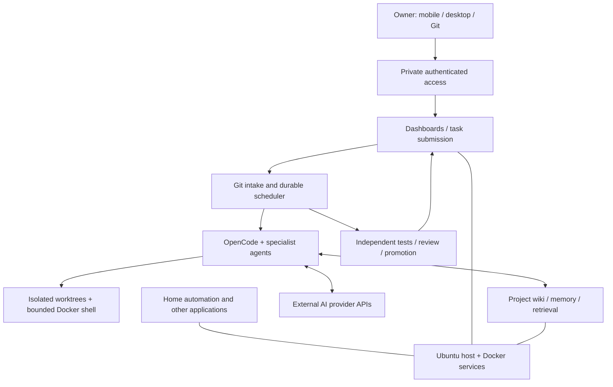

# HomeLab — November 2026 operational and AI infrastructure snapshot

> Sanitized architectural summary, checked against the private host on November 4, 2026. Not a live configuration export, production SLA, or complete network inventory.

## Runtime platform

The active home server runs **Ubuntu Server 24.04 LTS** on compact Intel-class hardware, with roughly **23 GiB usable RAM**, NVMe system storage and separate bulk storage. It combines host processes with selectively containerized services; describing everything as Docker-based would be inaccurate.

Different workloads coexist: home/environment integrations, application prototypes, observability and a Git-driven multi-agent engineering Farm. Services are operated through authenticated/private access, not documented here with hostnames, IP addresses, tokens or ports.

## Logical system architecture

The diagram is conceptual and intentionally omits topology-sensitive details.

## Observed components

On November 4, process inspection found the Farm Git watcher, scheduler, OpenCode API, submitter, supervision, Farm Hub, ai-memory, Hindsight and PostgreSQL running. Docker and Home Assistant were also active. A process being present is not proof that every feature or historic service is healthy.

## Engineering work and operational controls

- Git-backed, traceable software changes separated from sensitive runtime state.
- Task-scoped worktrees and executable acceptance criteria.
- Bounded model execution and independent read-only review.
- Container isolation for a tested subset of model-triggered shell tools.
- Durable task state and dashboards that distinguish `DONE`, `NOT_DONE`, `BLOCKED`, `PAUSED`, and owner decisions.
- Recovery work across API retries, model timeouts, review failures, dependency ordering and context handling.
- Local memory services combined with source-backed retrieval rather than treating model recollections as authoritative.

Specific E2E claims and limitations are documented in [Production Zoo's November architecture report](https://github.com/EvgenVLG/production-zoo/blob/main/docs/architecture/november-2026-private-farm.md).

## What this demonstrates

Hands-on Linux operations, process management, containers, service integration, observability, network troubleshooting, software engineering, evidence-based testing and technical ownership. It is a private engineering lab, not a multi-region enterprise production cluster.

No secrets, private addresses, credentials, raw task histories, home/device identities or server configuration dumps are published here.
